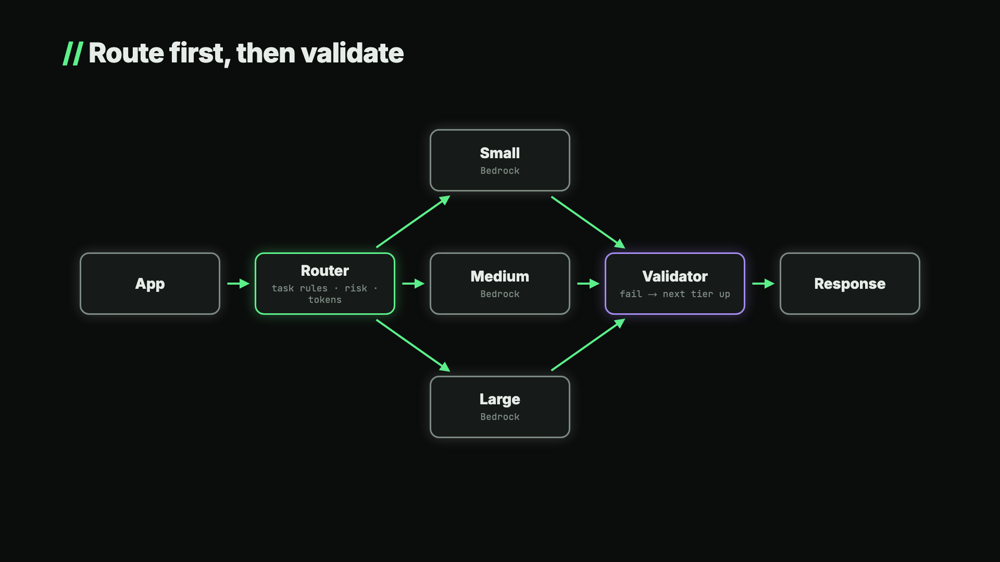

# V5: LLM routing with a validation cascade

Video: [LLM Routing: Stop Paying Premium Prices for Simple Prompts](https://www.youtube.com/watch?v=7kZ9mOlxuZo)



Each request goes to the cheapest model tier that is allowed to handle it. Every answer is validated, and a failure moves the request one tier up. Risky requests (legal, payment, medical) skip the cheap tiers no matter how short they are.

```
App → Router (plain code: task rule · risk tags · token count)
        → small | medium | large   (Bedrock, Converse API)
        → Validator (Zod schema + per-task checks)
            ok   → response
            fail → next tier up → … → large fails → a person (NeedsHuman)
every attempt → log (tier, ok, cost) → report + daily shadow check
```

| File | What it does |
|---|---|
| `src/router.ts` | `route`: task → tier map, unknown tasks go to large, long inputs get at least medium, risk tags go straight to large |
| `src/cascade.ts` | `createAsk`: call, validate, log, escalate; `NeedsHuman` when even large fails |
| `src/checks.ts` | Per-task JSON schema, prompt and checks (label in list, invoice lines add up, cited clauses exist) |
| `src/models.ts` | One Bedrock model per tier, cost from token usage and your prices |
| `src/log.ts` | One JSON row per attempt, plus a small sample of accepted cheap answers |
| `src/report.ts` | Per task: final tier, escalation rate, cost; flags tasks that should move up a tier |
| `src/shadow.ts` | Daily: re-runs sampled cheap answers on large and counts disagreements |
| `src/demo.ts` | The two requests from the video: the Acme invoice and the Globex contract question |

## Run it

```bash
cp .env.example .env   # three model ids and their prices
npm install
npm test               # router, cascade and report, with a fake model (no AWS needed)
npm run demo           # the two requests against Bedrock
npm run report
```

## Notes

- The tiers are about price and capability. Fill `MODEL_SMALL` / `MODEL_MEDIUM` / `MODEL_LARGE` with models you have tested on your own tasks; the numbers in the video are illustrative.
- `TASK_TIER` is a starting point. Move a task down a tier only after the shadow check agrees with large on a few hundred samples, and up a tier when `npm run report` shows it escalating more than ~5% of the time.
- Risk tags come from where the request starts (the contracts screen, the payments flow), never from the model.
- Validation catches broken answers, not mediocre ones. Tasks with free-text answers need a person reading the shadow samples.
- Amazon Bedrock Intelligent Prompt Routing picks between models of one family, is tuned for English prompts and can't see your validation results. It's a fine start; keep your own log either way.
